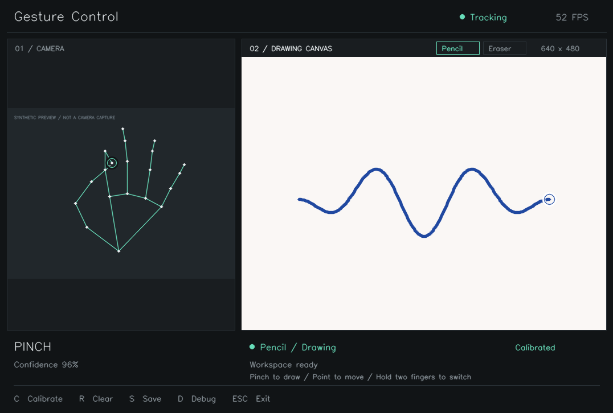

# Gesture Drawing

Draw on an OpenCV canvas with one hand and a standard webcam. Point to
position the brush, pinch to make a stroke, and hold up two fingers to switch
between pencil and eraser. The app manipulates the canvas, not your system mouse.



## Quick start

Use Python 3.12, a webcam, and a desktop display. From the repository root in
Windows PowerShell:

```powershell
py -3.12 -m venv .venv
.\.venv\Scripts\python.exe -m pip install -e ".[vision,ui]"
Invoke-WebRequest -Uri 'https://storage.googleapis.com/mediapipe-models/hand_landmarker/hand_landmarker/float16/1/hand_landmarker.task' -OutFile models/hand_landmarker.task
.\.venv\Scripts\python.exe -m gesture_control
```

On macOS or Linux, create the environment with `python3.12 -m venv .venv`, use
`.venv/bin/python` instead, and download the same model to `models/hand_landmarker.task`.
The model is downloaded separately; camera frames are processed on your computer.

## Controls

| Input | Action |
| --- | --- |
| Point / pinch | Aim on the canvas / draw or erase |
| Hold two fingers | Switch between pencil and eraser |
| `C`, then `Space` | Begin calibration and capture each of the four corners |
| `R` / `S` | Clear the canvas / export to `recordings/drawing.png` |
| `D` / `Esc` | Toggle diagnostics / quit |

Take your hand out of view or release the pinch to end a stroke. See
[the user guide](docs/USAGE.md) for calibration, model setup, and troubleshooting.

## Engineering

- MediaPipe detects hand landmarks. Palm-normalized geometry and temporal
  filtering turn them into stable gestures.
- A four-corner mapping converts camera-space fingertip positions to canvas
  coordinates. Stroke ownership stops one gesture from leaving a stray line
  across a tracking interruption.
- Capture keeps the most recent frame rather than accumulating a growing queue;
  rendering and input handling stay on the main thread.

See the [architecture](ARCHITECTURE.md) for component boundaries and
[the eraser and robustness report](docs/ERASER_ROBUSTNESS_RELEASE.md) for
historical design and validation notes.

## Testing

```powershell
.\.venv\Scripts\python.exe -m pip install -e ".[dev,vision,ui]"
.\.venv\Scripts\python.exe -m pytest
```

[CI](.github/workflows/ci.yml) uses synthetic and mocked inputs. It covers
gesture state, stroke mapping, calibration and cleanup without a physical
webcam. These checks do not measure real-world recognition accuracy or latency.
